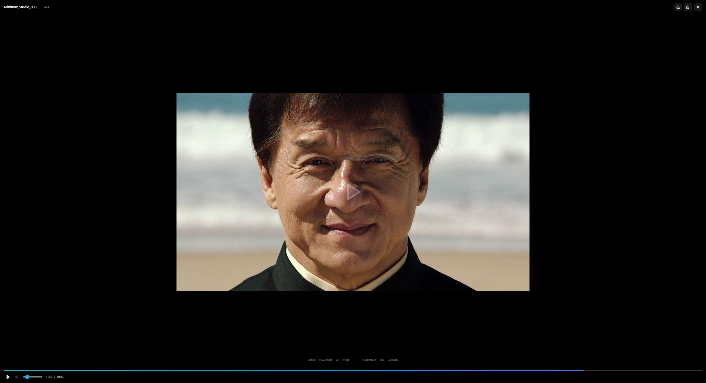

# MiniMax H3 Studio 7

Локальный веб-интерфейс для генерации кинематографичных видео со звуком на базе модели **MiniMax H3**. Работает полностью offline — нужен только NVIDIA GPU.

| | |
| --- | --- |
| **Версия** | 7.0.0 |
| **Платформа** | Windows 10/11 x64 |
| **Режим работы** | полностью локальный, без облака и телеметрии |
| **Требования** | NVIDIA GPU 8+ ГБ VRAM (12+ рекомендуется), драйвер CUDA 12.x |
| **Запуск** | `start.bat` — один файл, никаких установок |
| **Лицензия** | GPL-3.0 — см. [LICENSE](LICENSE) |

> **Статус:** проект опубликован. Установка из исходников — через `install.bat`,
> проверка локальной сборки — командой `npm run release`
> (clean → typecheck → build → prune → prepare → verify). Подробности —
> в разделе [Сборка релиза](#сборка-релиза).

## Скриншоты

| Главное окно | Генерация по референсу | Результат |
| :---: | :---: | :---: |
| [](screenshots/main-window.jpg) | [](screenshots/reference-generation.jpg) | [](screenshots/result-lightbox.jpg) |

## Установка на новую машину

### Как скачать

Если на странице проекта есть раздел **Releases**, берите архив оттуда — это
стабильная версия с описанием изменений. Если релизов ещё нет, скачайте
проект прямо со страницы GitHub:

1. Нажмите зелёную кнопку **Code** → **Download ZIP**.
2. Распакуйте архив в папку без пробелов и кириллицы в пути — например,
   `D:\Minimax_Studio`. Путь должен быть коротким: длинные пути ломают
   сборку Python-пакетов (в Windows есть ограничение на длину пути).
3. Запустите `install.bat` — он поставит ComfyUI, Python, torch и зависимости
   (см. ниже).
4. После установки запускайте программу через `start.bat`.

Если установлен Git, то же самое одной командой:

```
git clone https://github.com/EvgenRublev/Minimax_Studio.git
```

> В архиве только исходники: `node_modules`, ComfyUI, модели, DLSS-рантайм и
> whisper-модели не входят — их ставит `install.bat` или вы копируете вручную
> с рабочей машины (см. ниже).

Если проект **склонирован с GitHub** (то есть без `node_modules`,
`ComfyUI-Easy-Install`, `runtime` и других тяжёлых папок — они не хранятся в
репозитории), всё окружение ставится одним файлом:

```
install.bat
```

Скрипт скачает и настроит:

| Компонент | Версия |
| --- | --- |
| ComfyUI | сборка `5f0c4e1` (25.08.2026) + 4 патча проекта |
| Python | 3.12.10 (embedded) |
| torch / torchvision / torchaudio | 2.11.0+cu130 / 0.26.0 / 2.11.0 |
| Python-пакеты | 288, точные версии рабочего окружения |
| Кастомные ноды | 22 по зафиксированным коммитам + 4 собственные |
| Node.js | 22.20.0 (портативный, если в системе нет 18+) |
| Electron | 44.9.0 (окно приложения, а не браузер) |

Скачивается ~9 ГБ, установка занимает 20–60 минут в зависимости от скорости
интернета. Нужно **25 ГБ** свободного места.

**Модели не скачиваются** — после установки запустите `start.bat` и загрузите
их через UI: Настройки → Модели.

> **Что не восстанавливается.** Папки `upscale/bin` (DLSS 5, ~1.1 ГБ) и
> `stt` (whisper, ~168 МБ) не входят в репозиторий. Без них студия работает,
> но вкладки «Upscale» и «Голос» недоступны. Чтобы они заработали, скопируйте
> эти папки с рабочей машины рядом с `start.bat`.

Параметры установщика (`-Force`, `-SkipApp`, `-SkipComfy`, `-KeepCache`) и
разбор ошибок — в [install/README.md](install/README.md).

## Возможности

- **Генерация видео + аудио** — двухпроходная (low-res → latent upscale → high-res)
- **Референсы** — изображения (до 9), видео (до 3), аудио (до 3, с обрезкой по секундам)
- **Режим Draft** — быстрая однопроходная генерация; в галерее такие видео помечены красным бейджем «Draft»
- **LLM-ассистент** — по умолчанию **Qwen3.5 9B** (Q4_K_M, ~5.7 ГБ, со зрением); необязательный **Bonsai 2 27B** скачивается по запросу в `Bonsai_2_27B/`. Бэкенды `standard | bonsai | custom` (свой .gguf), в `[llm] model` маркеры `bonsai` / `bonsai_light` (лёгкий квант PTQ1_0) — помощь с промптами, видение референсов
- **Кастомные LoRAs** — добавление, удаление, триггер-ворды; встроенная Turbo LoRA включена по умолчанию во всех режимах (кроме «Кадров» с аудио, где пропускается автоматически)
- **Свободное разрешение** — от 0.2 до 3.0 МП, любой aspect ratio
- **Очередь генераций** — параллельные задачи, авто-очистка
- **Видеоплеер** — встроенный, с метаданными
- **Звуковой сигнал** — уведомление при завершении генерации
- **Голосовой ввод** — дикт (whisper, CPU): поле промпта, чат ассистента, редактор промптов (модели в `stt/models`, настройки — вкладка «Голос»)
- **Upscale (DLSS 5)** — встроенный DLSS 5 Visual Enhancer: Neural Rendering (шум/тон/структура), RTX VSR (апскейл 1–4×, опц. HDR) — нативная вкладка, без Gradio/iframe
- **Продление** — продолжение готового видео цепочкой клипов (вкладка «Продление»).
  Стык якорится тремя механизмами: хвост предыдущего
  клипа идёт в conditioning нативным keyframe-каналом H3, зона перекрытия
  жёстко фиксируется модель-обёрткой (перегенерация невозможна), а последний
  кадр предыдущего клипа подаётся картинкой-референсом с фразой
  непрерывности. Окно контекста 2 с, перекрытие сегментов 56 кадров. Шаги
  клипа — «авто» (из метаданных исходника), можно задать вручную
- **Refine** — повторная генерация с теми же референсами, но в большем разрешении (720p–2160p)
- **Tile Upscale** — чанковый апскейл: экономия VRAM, 720p–2160p, защита от выбора разрешения меньше исходника
- **FPS** — увеличение частоты кадров: RIFE VFI и FILM VFI (×2–×4), плавность движения на слабых GPU
- **Face Refine** — перерисовка мелких лиц в готовом ролике: нода находит лицо
  покадрово, перегенерирует его крупно и вклеивает обратно только область лица.
  Выбор субъекта — **кликом по лицу в кадре исходника**, правилом (самое
  крупное/левое/центр…) или **по фото конкретного человека** (сопоставление
  лиц, insightface). Живое превью генерации; на кадрах без лица работает
  детектор человека («далёкие планы»). Результат сохраняет AV-латент для
  lossless-рефайна
- **ControlNet (движение)** — генерация видео по карте движения из исходника
  (depth-препроцессор), для управления траекторией и хореографией сцены
- **Портативность** — один bat-файл, никаких установок

## Структура проекта

```
Minimax_Studio_V7/
├── start.bat                    ← запуск (единственная точка входа)
├── start_hidden.vbs             ← скрытый запуск (правка 570: консоль не видна в таскбаре)
├── install.bat                  ← установка окружения на чистой машине
├── install/                     ← установщик: install.ps1 + lock-файлы версий + comfy-patches/
├── README.md                    ← этот файл
├── CHANGELOG.md                 ← история изменений по версиям
├── server.js                    ← Next.js production server
├── package.json                 ← зависимости и скрипты
├── next.config.ts               ← конфигурация Next.js
├── tsconfig.json                ← TypeScript (strict + noUnusedLocals/Parameters)
├── postcss.config.mjs           ← Tailwind CSS
├── .env                         ← переменные окружения (COMFY_URL)
│
├── config/
│   └── config.ini               ← настройки приложения (VRAM, LLM, звук)
├── components.json              ← shadcn/ui
├── data/                        ← рабочие данные студии (создаются при работе,
│   │                              в репозиторий не входят)
│   ├── loras.json               ← список LoRA (турбо + кастомные)
│   └── assistant-chats.json     ← история чатов LLM-ассистента
├── prompts/                     ← справочные копии системных промптов (см. prompts/README.md)
├── scripts/
│   ├── build.mjs                ← production build с хипом Node 8 ГБ
│   ├── prune-build.mjs          ← ужатие сборки: кэш webpack + манифесты .nft.json
│   ├── clean.mjs                ← очистка артефактов сборки и мусора
│   ├── release.mjs              ← полный цикл релиза: clean → typecheck → build → prune → prepare → verify
│   ├── prepare-electron.mjs     ← копия electron.exe под именем MinimaxH3Studio.exe
│   ├── launch-electron.mjs      ← запуск окна (с правильным именем процесса)
│   ├── pe-version.mjs           ← чтение/сборка ресурса версии PE
│   ├── set-version-resource.ps1 ← вписывание ресурса версии (Win32 API)
│   ├── make-icons.mjs           ← перегенерация иконок
│   └── start_comfy.bat          ← запуск ComfyUI backend
├── Bonsai_2_27B/                ← portable llama.cpp (форк PrismML) + тернарная
│   │                              модель ассистента Bonsai 2 27B (llama-server);
│   │                              создаётся автодокачкой при выборе Bonsai
├── upscale/                     ← DLSS 5 Visual Enhancer (вкладка «Upscale»)
│   ├── bridge.py                ← headless JSON-мост (stdlib, embedded Python)
│   ├── src/                     ← пайплайны: NR / VSR / FI
│   └── bin/                     ← embedded Python 3.13 + ffmpeg (amd64)
├── stt/                         ← встроенный whisper STT (вкладка «Голос») — рантайм
├── tools/                       ← llm_server.py / stt_server.py (Python-обёртки)
│   └── ck_pkg/                  ← офлайн-установщик comfy-kitchen (для --use-ck-attention;
│                                  сам пакет уже установлен в python_embeded)
│
├── src/                         ← исходный код (Next.js App Router)
│   ├── app/                     ← страницы и API-маршруты
│   ├── components/h3/           ← интерфейс студии
│   ├── components/ui/           ← shadcn/ui
│   ├── lib/                     ← бизнес-логика и состояние (zustand)
│   └── hooks/                   ← React-хуки
├── electron/                    ← окно приложения (main.js + preload.js + иконки)
├── public/                      ← статические файлы (логотип, splash-videos/)
├── .next/                       ← production build (создаётся `npm run build`)
├── runtime/
│   └── node.exe                 ← bundled Node.js (если нет в PATH)
├── node_modules/                ← npm зависимости
└── ComfyUI-Easy-Install/        ← portable ComfyUI + модели
```

## Требования

| Компонент | Версия                                         |
| --------- | ---------------------------------------------- |
| ОС        | Windows 10/11 x64                              |
| GPU       | NVIDIA, 12+ ГБ VRAM (рекомендуется), мин. 8 ГБ |
| Драйвер   | CUDA 12.x                                      |
| Node.js   | 18+ LTS (или bundled `runtime\node.exe`)       |
| ComfyUI   | Portable, папка `ComfyUI-Easy-Install`         |

## Запуск

```
start.bat
```

Скрипт сразу перезапускает себя в **свёрнутом окне** (консоль не мешает) и автоматически:

1. Находит Node.js (PATH → `runtime\node.exe` → ошибка)
2. Проверяет наличие `ComfyUI-Easy-Install/`
3. Устанавливает `node_modules` если нет
4. Собирает `.next` если нет
5. Запускает студию в **собственном окне приложения (Electron)**: без адресной строки и табов, своя иконка и имя в таскбаре. Electron сам поднимает Web UI (:3000) и ComfyUI (:8188, флаги VRAM из `config.ini`), открывает окно с экраном-заставкой `/splash` — она сама ждёт готовности бэкенда и входит в приложение. **Закрытие окна останавливает всё** (веб-сервер, ComfyUI и их дочерние процессы); свёрнутая консоль — лог.
6. Если Electron недоступен (например, `node_modules` скопирован без него) — фолбэк на прежний режим: сервер в фоне + обычная вкладка браузера.

**Стоп:** закрыть окно приложения (или консоль — она держит фоновые процессы).

### Имя процесса в диспетчере задач

Окно студии в диспетчере задач называется **MinimaxH3Studio**, а не «electron»:
так его не перепутать с другими Electron-приложениями, если потребуется
прибить процесс.

Механизм: `scripts/prepare-electron.mjs` создаёт рядом с `electron.exe`
копию `MinimaxH3Studio.exe` (в той же папке `dist`, поэтому Electron находит
свои ресурсы как обычно) и вписывает в неё ресурс версии — «Свойства
файла» и колонка «Имя продукта» тоже показывают студию, а не
`Electron / GitHub, Inc.`. Копия занимает ~236 МБ; штатный `electron.exe`
остаётся нетронутым, поэтому `npm install` и `npm run desktop` работают
как прежде.

Копия создаётся автоматически при `start.bat` (и при `npm run release`);
вручную — `npm run prepare:electron`. Если копии нет, приложение
запускается обычным `electron.exe` — просто в диспетчере будет «electron».

## Настройки

Все настройки — в Web UI (иконка шестерёнки) и в `config/config.ini`:

| Параметр                | Описание                                        |
| ----------------------- | ----------------------------------------------- |
| `reserve_gb`            | VRAM, зарезервированная для системы (ГБ)        |
| `dynamic_vram`          | Динамическое управление VRAM ComfyUI            |
| `vram_headroom`         | Доп. запас свободной VRAM для DynamicVRAM (0–8 ГБ, по умолчанию 2; 0 = выкл) |
| `async_offload`         | Асинхронный офлоад загрузки моделей (0 = синхронно, стабильно; 1 = быстрее, на RTX 50xx может падать) |
| `comfy.turbo_lora`      | Зарезервировано (в коде не читается; Turbo LoRA управляется из UI) |
| `comfy.diffusion_model` | Альтернативная базовая модель (пусто = default) |
| `llm.device`            | `auto` / `gpu` / `cpu` — где считается LLM      |
| `llm.context_size`      | Контекстное окно LLM (токены, default 25600)    |
| `llm.max_output_tokens` | Макс. длина ответа LLM                          |
| `llm.model`             | Бэкенд LLM: пусто/`bonsai` = Bonsai PQ2_0, `bonsai_light` = Bonsai PTQ1_0, имя файла = standard-бэкенд |
| `llm.temperature` / `llm.top_p` / `llm.min_p` / `llm.top_k` | Сэмплинг LLM (действуют при `sampling_override=1`) |
| `llm.repeat_penalty` / `llm.frequency_penalty` / `llm.presence_penalty` | Штрафы сэмплинга LLM |
| `llm.sampling_override` | 1 = применять параметры сэмплинга из config поверх дефолтов |
| `llm.kv_cache`          | Тип KV-кэша llama.cpp: `off` / `q8_0` / `q5_1` / `q4_0` |
| `llm.video_vision`      | Видение видео-рефов ассистентом (1/0; по умолчанию 1 — сжатый digest с кэшем) |
| `llm.custom_model_path` | Свой .gguf (абсолютный путь) — бэкенд `custom`, приоритетнее `llm.model` |
| `llm.custom_mmproj_path` | Свой mmproj для custom-модели (зрение)         |
| `ui.sound_on`           | Звук при завершении генерации (1/0)             |
| `stt.enabled`           | Голосовой ввод вкл/выкл (1/0)                   |
| `stt.model`              | Модель STT (пусто = авто, первая найденная)     |
| `stt.language`           | Язык распознавания: `ru` / `en` / `auto`        |
| `stt.threads`            | Потоки CPU (0 = авто)                           |
| `upscale.enabled`         | Вкладка Upscale вкл/выкл (1/0)                  |
| `upscale.port`            | Порт DLSS-моста (по умолчанию 7890)             |
| `models.extra_paths`      | JSON-массив `[{path, category}]` дополнительных путей поиска моделей |

## Модели

Все модели скачиваются из Web UI → Настройки → Модели. Реестр — `src/lib/models-config.ts`;
размеры в нём записаны **точным числом байт** (= `content-length` на сервере), поэтому
проверка «файл скачан целиком» не срабатывает ложно.

Основные файлы — в `ComfyUI-Easy-Install/ComfyUI/models/`:

| Тип             | Файл                                                                                         | Размер   |
| --------------- | -------------------------------------------------------------------------------------------- | -------- |
| Diffusion       | `diffusion_models/minimax_h3_fastvideo_vsa_datafree_1300step_4step_int8_convrot.safetensors`               | ~22.9 ГБ |
| Text Encoder    | `text_encoders/qwen3vl_32b_minimax_h3_nvfp4_awq.safetensors`                                 | ~15.7 ГБ |
| VAE (video)     | `vae/minimax_h3_video_vae_int8_convrot.safetensors`                                        | ~2.8 ГБ  |
| VAE (audio)     | `vae/minimax_h3_audio_vae_fp32.safetensors`                                                  | ~0.6 ГБ  |
| Turbo LoRA      | `loras/minimax_h3_ref2v_turbo_4step_v0.1_comfyui_bf16.safetensors` (обязательна; включена по умолчанию, кроме «Кадров» с аудио) | ~1.8 ГБ  |
| Latent Upscaler | `latent_upscale_models/minimax_h3_latent_upscaler_3d_fp16.safetensors`                       | ~691 МБ  |
| TAE Preview     | `vae_approx/taeh3.safetensors`                                                               | ~9.8 МБ  |
| Veda (опциональна) | `veda/minimax_h3_t2va_veda_8nfe_600step_preview_fp8.safetensors`                          | ~275 МБ  |

LLM-ассистент — выбор через `[llm] model` (имя файла) в `config/config.ini`:

| Бэкенд | Файл | Размер |
| ------ | ---- | ------ |
| standard | `llm/gemma-4-12b-it-Q3_K_M.gguf` / `Q4_K_M` / `Q5_K_M` (+ `llm/mmproj-BF16.gguf` для зрения) | ~5.7 / 7.1 / 8.4 ГБ |
| standard | `llm/qwen3.5-9b/Qwen3.5-9B-Q4_K_M.gguf` (+ `llm/qwen3.5-9b/mmproj-F16.gguf`) — **по умолчанию** | ~5.7 ГБ + ~918 МБ |
| bonsai | `Bonsai_2_27B/models/Ternary-Bonsai-2-27B-PQ2_0.gguf` (+ `bonsai_light` = PTQ1_0) + `Ternary-Bonsai-2-27B-mmproj-Q8_0.gguf` | ~7.2 / 5.95 ГБ + ~630 МБ |
| custom | свой `.gguf` по абсолютному пути (`[llm] custom_model_path`) | — |

Модели FPS лежат **вне** `ComfyUI/models` — в папке `ckpts` пакета
ComfyUI-Frame-Interpolation:

| Тип | Файл | Размер |
| --- | ---- | ------ |
| FPS (RIFE) | `ComfyUI/custom_nodes/ComfyUI-Frame-Interpolation/ckpts/rife/rife49.pth` | ~21.3 МБ |
| FPS (FILM) | `ComfyUI/custom_nodes/ComfyUI-Frame-Interpolation/ckpts/film/film_net_fp32.pt` | ~131.5 МБ |

Препроцессор глубины (вкладка «ControlNet», опционально) — в папке `ckpts` ноды
`comfyui_controlnet_aux`: `ckpts/depth-anything/Depth-Anything-V2-Small/depth_anything_v2_vits.pth` (~99 МБ).

Скачивание моделей — в Web UI → Настройки → Общие → Модели.

> **Примечание:** модели FPS скачиваются в общих настройках программы, а не при первом запуске генерации. В режиме RIFE VFI используется только `rife49.pth`, в режиме FILM VFI — `film_net_fp32.pt`.

## Вкладка Upscale (DLSS 5)

Встроенный **DLSS 5 Visual Enhancer** (папка `upscale/`, полный портативный рантайм: embedded Python + DLL-рантаймы). Нативная вкладка программы — **не Gradio, не iframe**: форма, прогресс-бар и результат — внутри UI.

Layout повторяет вкладку «Генерация»: слева — панель параметров (сервис, GPU, параметры режима, кодирование) и закреплённый блок статуса job; справа — выбор режима + загрузка видео + кнопка запуска; внизу — **общая галерея видео** (та же, что в «Генерация» и «Галерея»): результаты апскейла пишутся в общую папку output ComfyUI, поэтому видятся во всех местах и чистятся кнопкой «Удалить контент».

Работаем **только с видео** (подрежимы картинок в UI не выводятся).

### Возможности

| Фича | Что делает |
| ---- | ---------- |
| **Neural Rendering** | Подавление шума и артефактов: пресеты, стиль (Natural/Cinematic), интенсивность, локальный тон/структура, DLSS-модель (J/K/L/M), коэффициент 1×–3×, опц. «сохранить HDR» |
| **RTX VSR** | Нейро-апскейл 1×–4× (Low→Ultra), произвольный размер, **опциональный HDR-режим** (контраст/насыщенность/пиковая яркость) |

Для каждого режима: выбор GPU (AI-пайплайн и видео-пайплайн отдельно), кодек (H.264/H.265/AV1/ProRes, CPU или NVENC), качество кодирования, контейнер (MP4/MKV/MOV).

### Как пользоваться

1. Откройте вкладку **Upscale** — сервис поднимется автоматически (первый старт до 2–3 минут: подготовка DLL, детект GPU).
2. Выберите режим: **Neural Rendering** или **RTX VSR**.
3. Перетащите видео или выберите его — программа загрузит его в `data/upscale-input/` и покажет метаданные (разрешение, FPS, длительность, кодек, HDR).
   Видео можно взять прямо из галереи: перетащите превьюшку в поле загрузки (работает из любой вкладки, где есть галерея) либо нажмите кнопку **✨** на карточке видео — программа сама переключится на Upscale и подхватит файл.
4. Настройте параметры в левой панели → **Запустить**. Прогресс виден в реальном времени, отмена — кнопкой **Отменить**.
5. Готовый файл появится в общей галерее ниже (и во вкладке «Галерея»). Скачать — кнопка ⬇ на карточке видео (появляется при наведении).

### Требования

- Windows 10/11 x64
- NVIDIA RTX (20/30/40/50) с актуальным драйвером — без RTX вкладка честно сообщает, что рантайм не готов
- Live-режим (real-time/HLS) в студию **не входит**: это отдельный инструмент
  (свой HLS-сервер и плеер), а не обработка файла. Вкладка «Upscale»
  работает только с готовыми видеофайлами.

## Архитектура

```
Браузер (:3000)
  │
  ├─ Next.js App Router (React 19, Tailwind, shadcn/ui)
  │
  ├─ /api/comfy/*  ── прокси ──►  ComfyUI (:8188)
  │                                │
  │                                └─ Workflow: MiniMax H3 Ref2VA
  │                                   Two-Pass Latent Upscaler
  │
  ├─ /api/llm/chat  ──►  llama.cpp: Bonsai 2 27B (llama-server из Bonsai_2_27B/,
  │                      бэкенд bonsai, default) / GGUF standard (tools/llm_server.py)
  │                      / custom (свой .gguf)
  │
  ├─ /api/upscale/* ─►  bridge.py (DLSS 5, embedded Python, порт 7890)
  │                     └─ пайплайны: Neural Rendering / RTX VSR
  │
  └─ Файлы: ComfyUI/output/ (видео), ComfyUI/input/ (референсы)
```

**Workflow (Two-Pass):**

1. **Pass 1** — low-res (default 0.2 MP; потолок `min(2, max(finalRes, 1.0))` МП, т.е. не выше финального разрешения, но не ниже 1.0 МП; 2–30 шагов, default 6 из 6; сэмплер и планировщик на выбор, default `euler` / `simple`)
2. **Latent Upscale** — `MinimaxH3LatentUpscaler3D` → целевое разрешение (`enable_chunking: true`)
3. **Pass 2** — high-res refinement (3–7 шагов, сэмплер на выбор (default `euler`), ManualSigmas)
4. **Decode** — VAEDecode (video) + VAEDecodeAudio (audio)
5. **Output** — H.264 MP4, 24 fps

Все параметры проходов (сэмплеры, планировщик, разрешение pass 1) + влияние турбо-лоры (default 1.0) настраиваются в «Дополнительных параметрах».

**Оптимизация VRAM:**

- `MiniMaxLowVRAMAttention` — head-chunked attention
- `MiniMaxChunkFeedForward` — chunked FFN для длинных последовательностей

## Кастомные ноды ComfyUI

| Нода                                          | Назначение                     |
| --------------------------------------------- | ------------------------------ |
| `MiniMaxH3ReferenceToVideo`                   | Основной H3 узел               |
| `MiniMaxH3AddGuide`                           | Подача аудио-референсов в t2v/flf (Audio Guide) |
| `MiniMaxH3AudioOrSilent` / `MiniMaxH3AudioSliceFrom` | Аудио исходника (или тишина) и срез хвоста — в патче ядра `comfy-patches` |
| `MiniMaxStudioSaveAVLatent` / `MiniMaxStudioLoadAVLatent` | Сохранение/загрузка AV-латента для lossless-рефайна (`custom nodes/minimax_studio_av_latent/`) |
| `MiniMaxStudioAudioTrim` / `MiniMaxStudioAudioGain` | Обрезка/громкость аудио-референсов (`custom nodes/minimax_studio_audio_trim/`) |
| `MiniMaxStudioExtendKeyframes` / `MiniMaxStudioLatentLock` | Якорь хвоста и жёсткий лок перекрытия в продлении (`custom nodes/minimax_studio_extend/`) |
| `MiniMaxH3SigmaShift`                         | Сдвиг сигма-распределения      |
| `MiniMaxLowVRAMAttention`                     | Экономия VRAM (attention)      |
| `MiniMaxChunkFeedForward`                     | Экономия VRAM (FFN)            |
| `MinimaxH3LatentUpscaler3D`                   | Апскейл латента                |
| `LTXVSeparateAVLatent` / `LTXVConcatAVLatent` | Разделение AV латентов         |
| `ModelPreviewOverrideKJ`                      | Живое превью шагов             |
| `ComfyMathExpression`                         | Математические выражения       |
| `VHS_VideoCombine`                            | Выход видео (VideoHelperSuite) |

## Команды (разработка)

```bash
npm install          # зависимости
npm run dev          # dev server (:3000)
npm run desktop      # окно приложения (Electron) — сервер и ComfyUI поднимутся сами
npm run icons        # перегенерация иконок (electron/icons + public/icon-*) из logo.svg
npm run build        # production build (автоматически поднимает хип Node до 8 ГБ)
npm run build:default  # production build с хипом по умолчанию (без обёртки)
npm run typecheck    # TypeScript проверка
npm run check        # typecheck + build (то же, что делает release)
npm run clean        # очистка .next, кэшей Python, логов и прочего мусора
npm run release      # полный цикл релиза: clean → typecheck → build → prune → prepare → verify
npm run prepare:electron  # пересоздать MinimaxH3Studio.exe (имя процесса в диспетчере)
```

> **Сборка и память.** `npm run build` запускает `next build --webpack` через
> обёртку [scripts/build.mjs](scripts/build.mjs), которая задаёт хип Node 8 ГБ
> (`--max-old-space-size=8192`) — иначе сборка падает с
> `JavaScript heap out of memory`. Размер хипа можно переопределить:
> `NEXT_BUILD_HEAP_MB=12288 npm run build`. Lint-скрипт удалён: eslint в проекте
> не используется (проверка типов — `npm run typecheck`).

> **Строгость типов.** В `tsconfig.json` включены `noUnusedLocals` и
> `noUnusedParameters` — мёртвые импорты и неиспользуемые локальные
> переменные ломают `npm run typecheck`. Это защищает от повторного
> накопления «мёртвого» кода между релизами.

## Сборка релиза

Релиз — это **папка**, а не архив: распакованный проект запускается двойным
кликом по `start.bat`, никакой установки не требуется. Для передачи папку
можно упаковать в ZIP — содержимое и запуск от этого не меняются.

```bash
npm run release
```

Скрипт выполняет шесть шагов:

1. **clean** — удаляет `.next/`, кэш TypeScript, `__pycache__/`, логи и
   мусорные файлы в корне (в т.ч. `_nul` — ловушку Git Bash).
2. **typecheck** — `tsc --noEmit` со `strict` + `noUnusedLocals`/`noUnusedParameters`.
3. **build** — production-сборка Next.js в `.next/`.
4. **prune** — ужимает сборку: удаляет `.next/cache/` (кэш webpack для
   пересборок, ~300 МБ) и обрезает манифесты `.nft.json` (~530 МБ), в которых
   перечислены ~87 000 файлов деревьев ComfyUI / embedded-Python. В рантайме
   они не нужны: `server.js` запускает `next()` из `node_modules`.
   **Итог: `.next` с 841 МБ → 8 МБ.**
5. **prepare** — создаёт `MinimaxH3Studio.exe`, чтобы процесс окна в
   диспетчере задач не назывался «electron».
6. **verify** — проверяет, что релиз собран целиком:

   | Проверка | Зачем |
   | -------- | ----- |
   | `.next/BUILD_ID`, `.next/server`, `.next/static` | сборка действительно есть и полная |
   | `node_modules/` + `node_modules/electron/dist/electron.exe` | без Electron приложение уйдёт в браузерный режим |
   | `node_modules/electron/dist/MinimaxH3Studio.exe` | правильное имя процесса в диспетчере |
   | `start.bat`, `start_hidden.vbs`, `server.js` | точка входа на месте |
   | `.env` | без него не найдётся ComfyUI-бэкенд |
   | `config/config.ini` | настройки по умолчанию |
   | `public/splash-videos/`, `public/logo.svg` | заставка и логотип |
   | в корне нет `*.log`, `_nul`, `*.tsbuildinfo` | в релиз не попадёт мусор |

Проверить релиз **без пересборки** (например, перед копированием на флешку):

```bash
node scripts/release.mjs --verify
```

### Что копировать получателю

| Копировать | Обязательно | Примечание |
| ---------- | ----------- | ---------- |
| Весь проект целиком | ✔ | включая `node_modules/`, `.next/`, `runtime/`, `stt/`, `upscale/` |
| `ComfyUI-Easy-Install/` | ✔ | портативный ComfyUI **без моделей** — модели скачиваются через UI: Настройки → Модели (см. [Модели](#модели)) |
| `Bonsai_2_27B/` | — | создаётся автодокачкой при выборе Bonsai |
| `data/` | — | можно очистить: LoRA-лист и история чатов |
| `config/config.ini` | ✔ | можно сбросить к дефолтам |

> **Модели в поставку не входят.** Портативная сборка занимает ~6 ГБ без
> моделей; после первого запуска скачайте их через Настройки → Модели
> (см. [Модели](#модели)). Так архив остаётся компактным, а модели не
> дублируются у каждого получателя.

> **Перед передачей программы другому человеку** откройте
> Настройки → Сброс → **«Полный сброс (всё)»**. Он удаляет сгенерированные
> видео и кэш ComfyUI, файлы апскейла, вложения и историю чатов, промпты,
> журналы (включая внутренние логи и базу ComfyUI) и локальные данные, а
> настройки/LoRA/`config.ini` возвращает к заводским. Модели, `custom_nodes`
> и код программы не трогаются — после сброса не остаётся ничего вашего, а
> программа продолжает работать.

> **Важно:** `node_modules/` и `.next/` должны попасть к получателю **целиком**
> и с того же Windows x64. Иначе `start.bat` попробует пересобрать проект
> (нужен `npm` и время) или уйдёт в браузерный режим вместо окна приложения.

## Лицензия

Copyright (C) 2026 Evgen Rublev.

Проект распространяется под **GNU General Public License v3.0** — полный текст
в файле [LICENSE](LICENSE).

Кратко: программу можно бесплатно использовать, изучать, менять и
распространять. Если вы распространяете изменённую версию — она должна
оставаться открытой под той же лицензией GPL-3.0, с указанием авторства.
Гарантий нет: программа предоставляется «как есть».

Файлы в `install/comfy-patches/` — изменённые файлы **ComfyUI**, который
распространяется под GPL-3.0; они остаются под GPL-3.0. Сторонние
библиотеки (Next.js, React, Electron, ComfyUI и другие) сохраняют свои
лицензии.

